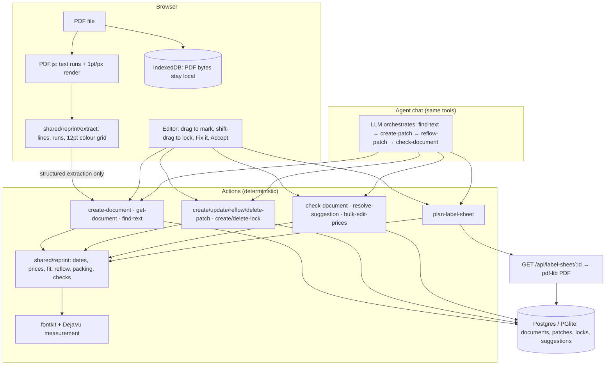
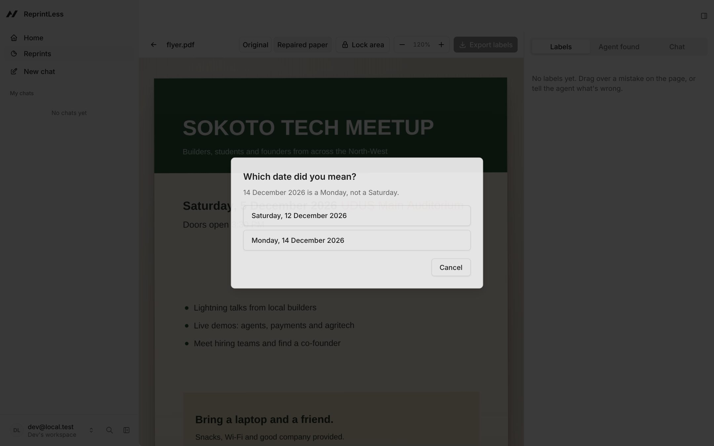
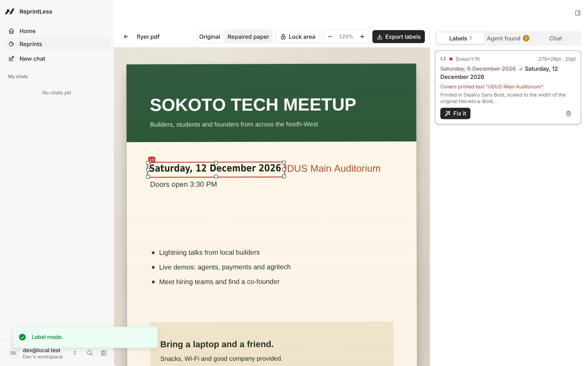
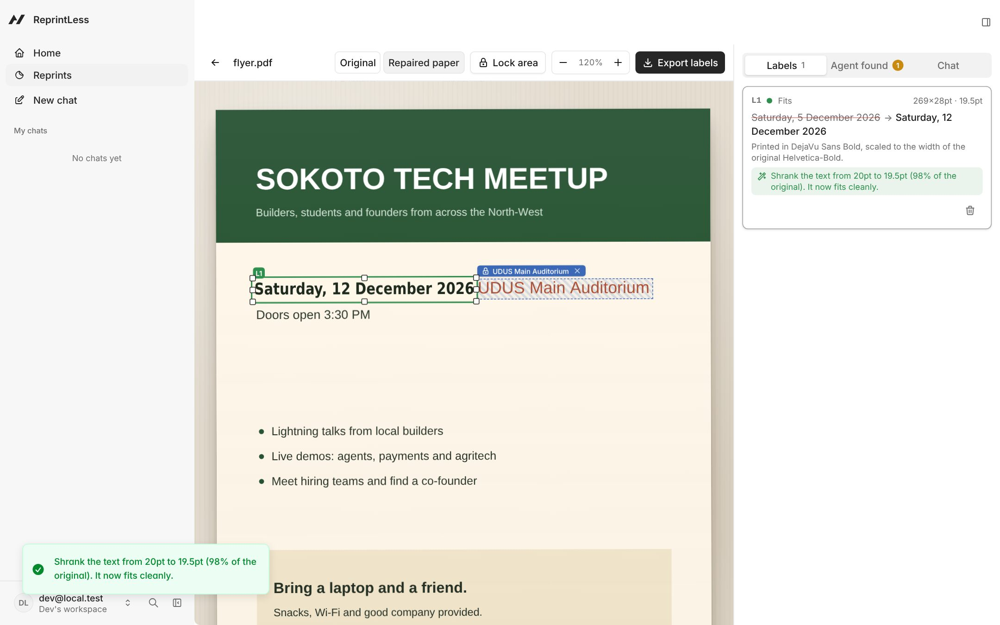
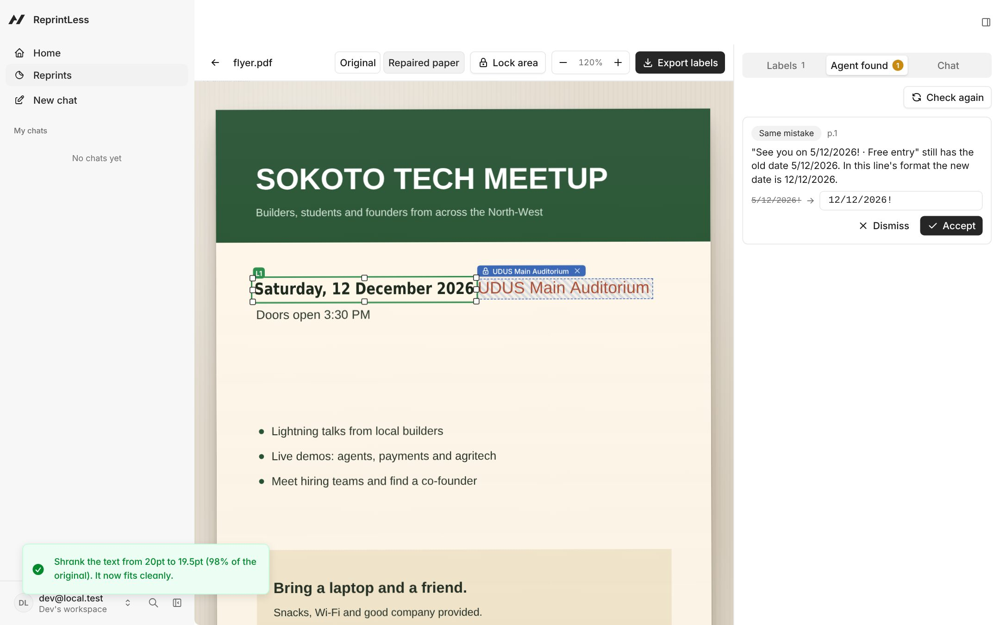
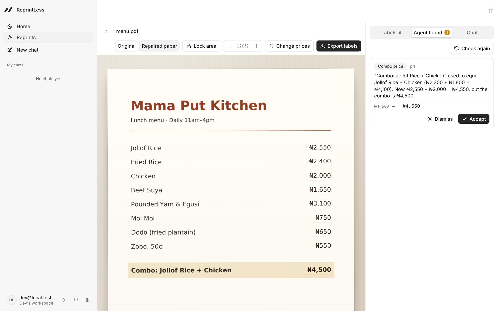
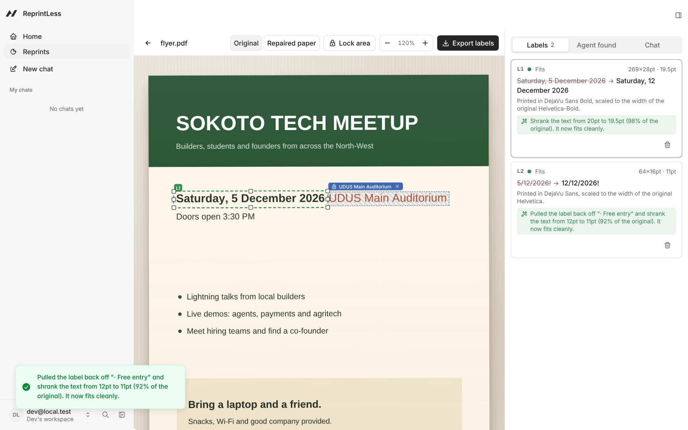
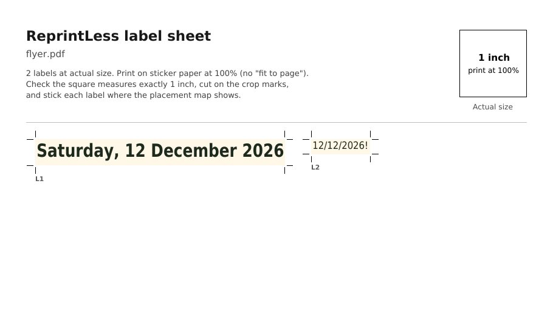
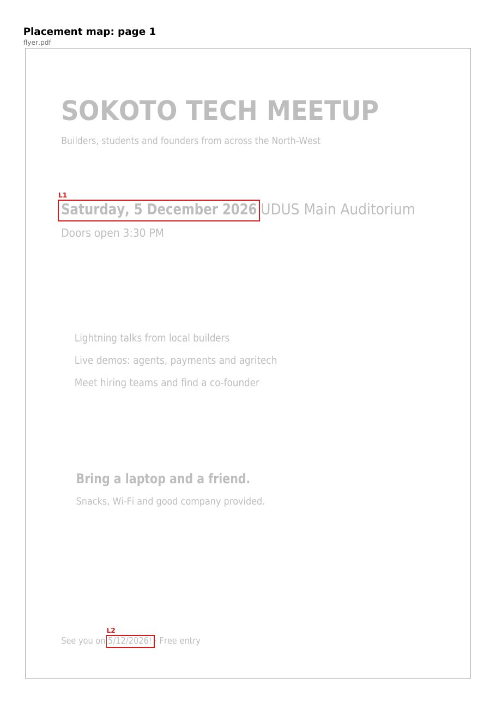

<div align="center">

# 🏷️ ReprintLess

**Fix the print run, not the printer bill.**

You printed 200 flyers, then spotted the wrong date. ReprintLess makes correctly sized cover-up stickers for each mistake, printed at actual size with crop marks and a map of where each one goes. Its agent also finds the mistakes you *didn't* mark.

<br/>


</div>

| | |
|-|-|
| **Hackathon** | Builder.io Agent-Native Hackathon (deadline 9 Nov 2026) |
| **Source** | [github.com/ahmardchain/ReprintLess](https://github.com/ahmardchain/ReprintLess) |
| **Run it** | `pnpm install && pnpm exec agent-native dev` → open `/reprint` → **Try a sample** |
| **Stack** | Agent-Native (Chat template) · React Router 8 · Drizzle + Postgres/PGlite · PDF.js · pdf-lib + fontkit · DejaVu fonts |

---

## The problem

A wrong date or price on a print run is usually fixed one of two bad ways: reprint everything, or hand-write corrections. Stickers are the cheap middle path, but making them well is fiddly. Each one has to be the right size, in a matching font and colour, must not cover the venue next to the date, and must be stuck in the right place. And the mistake rarely appears only once: the date you fixed in the header is also in the footer, in a different format.

**ReprintLess** turns that into a two-minute job:

- ✅ Drag over a mistake (or tell the agent) and get a label sized to fit, with background and text colour matched from the page.
- ✅ A fit check that catches labels covering other text, locked areas, or each other, plus a one-click **Fix it** that shrinks, grows or wraps the text.
- ✅ An agent that catches what you didn't mark: the same date in other formats, weekdays that don't match their date, past dates, combo prices that stop adding up, mixed currency symbols.
- ✅ A printable PDF: labels at exact size with crop marks and IDs, a 1-inch calibration square, and a placement map per page.

## 30-second demo

1. **Try a sample → Event flyer.** Drag over *"Saturday, 5 December 2026"* and type *"Saturday, 14 December 2026"*.
2. ReprintLess refuses to guess: **14 December 2026 is a Monday.** Pick *Saturday, 12 December* or *Monday, 14 December*.
3. The label is made, but the new date is longer, so it covers *"UDUS Main Auditorium"* and turns **red**.
4. Shift-drag over the venue to **lock** it, pull the label's edge back, click **Fix it**: *"Shrank the text from 20pt to 19.5pt (98% of the original). It now fits cleanly."* Green.
5. **Agent found** shows the footer: *"See you on 5/12/2026!"* still has the old date. In that line's own format the new date is **12/12/2026!** Accept.
6. **Restaurant menu → Change prices → +10%, round to ₦50 → Apply.** Nine price labels, and the agent flags the combo: *₦2,550 + ₦2,000 = ₦4,550, but the combo is ₦4,500.*
7. **Export labels** → A4 PDF with crop marks, L1/L2… IDs, the calibration square and the placement map.

The same flow works by chat: *"The date is wrong, it should be Saturday, 14 December 2026."*

## Contents

- [How it works](#how-it-works)
- [Actions](#actions)
- [Key design decisions](#key-design-decisions)
- [Screenshots](#screenshots)
- [What's real](#whats-real)
- [Getting started](#getting-started)
- [Project structure](#project-structure)
- [Limitations](#limitations)
- [Originality](#originality)

## How it works

Every capability is one deterministic action. The UI calls it through `useActionQuery`/`useActionMutation`; the agent calls the same action as a tool. There are **no LLM calls inside actions**: geometry, date maths, price maths and fit checks are plain code with tests. The intelligence is the agent choosing and sequencing them.



```mermaid
sequenceDiagram
  participant U as User
  participant Ag as Agent
  participant A as Actions
  U->>Ag: "The date is wrong, it should be Saturday, 14 December 2026"
  Ag->>A: find-text "Saturday, 5 December 2026"
  Ag->>A: create-patch findText + newText
  A-->>Ag: fail weekday_mismatch (Sat 12 Dec / Mon 14 Dec)
  Ag->>U: 14 Dec 2026 is a Monday. Saturday 12 or Monday 14?
  U->>Ag: Saturday 12 December
  Ag->>A: create-patch → status error (covers the venue)
  Ag->>A: reflow-patch → "Shrank the text 20pt → 19.5pt", ok
  Ag->>A: check-document → footer "5/12/2026!" → "12/12/2026!"
  Ag->>U: Fixed. The footer has the same date; want me to label it too?
```

**Data model** (all coordinates in PDF points, origin top-left): `reprint_documents` (ownable, shareable; pages as JSON lines + colour grid), `reprint_patches`, `reprint_locks`, `reprint_suggestions` (children checked through their parent document). Migrations are named and additive (`server/plugins/db.ts`).

## Actions

| Action | Agent | What it does |
|-|-|-|
| `create-document` | UI only | Save the browser's PDF.js extraction (max 20 pages; scanned PDFs rejected) |
| `list-documents` | ✅ | Documents the user can open |
| `get-document` | ✅ | Pages, labels with fit status, locks, open suggestions; lines with `includeLines` |
| `find-text` | ✅ | Matches with a sub-line bounding box from runs + font measurement |
| `create-patch` | ✅ | Mark the mistake and size its label in one call; `weekday_mismatch` returns both alternatives |
| `update-patch` | ✅ | Move/resize, change text, size or alignment; re-checks the page |
| `reflow-patch` | ✅ | Pick the least intrusive fit (shrink ≤15%, grow right/left/down, wrap, shrink to 6pt) that covers no lock, text or label |
| `delete-patch` | ✅ | Remove a label |
| `create-lock` / `delete-lock` | ✅ | Protect an area (by rect or text) |
| `check-document` | ✅ | Replace open suggestions: related mentions, weekday, past date, combo, currency |
| `resolve-suggestion` | ✅ | Accept (create or update the label, auto-fix if it doesn't fit) or dismiss |
| `bulk-edit-prices` | ✅ | % change with rounding, exact integer maths; `dryRun` preview, then one transaction |
| `plan-label-sheet` | ✅ | Shelf-packed layout plus the PDF download URL |
| `GET /api/label-sheet/:id` | route | The binary PDF (the only non-action endpoint) |

**Fit status.** `error`: text doesn't fit, or the label covers a lock, other printed text or another label. `warn`: font shrunk below 85% of the original, or the background wasn't a flat colour (white label with a thin border). Font substitution is info only. Every warning carries a one-line human message.

## Key design decisions

**1. Labels keep the original's width even when the font is substituted.** The PDF standard fonts can't print `₦`, so every label is set in DejaVu, the same TTFs in the PDF (pdf-lib + fontkit) and on screen (`@font-face`), so preview equals print. But DejaVu Sans Bold is ~20% wider than Helvetica-Bold: a naive label for "Saturday, 12 December 2026" grew to 333pt and needed a 25% shrink.

- ❌ Measure with DejaVu as-is → oversized labels and heavy shrinking.
- ❌ Use condensed DejaVu → still the wrong width, and only for some fonts.
- ✅ Compare the printed run's real width (from PDF.js) with DejaVu's for the same text, and apply that ratio as horizontal scaling (`Tz` in the PDF, `scaleX` on screen). Measurement, layout, fit and reflow all use the scaled metric.

```ts
// server/lib/reprint.ts
export function widthScale(line: Line | null): number {
  const measured = measureText(line.text, line.fontFamily, line.bold, line.fontSize);
  const ratio = line.w / measured;
  return Math.abs(ratio - 1) < 0.02 ? 1 : Math.min(1.1, Math.max(0.75, ratio));
}
```

**2. Dates are matched by value and re-written in each mention's format.** `findDates` reads `Saturday, 5 December 2026`, `Sat 5 Dec`, `5/12/2026` (D/M/Y), `05.12.26`, `2026-12-05`, `5th December` and `December 5, 2026`, and records the format (weekday style, ordinal, padding, separators, year width, case). Fixing the header date suggests `12/12/2026!` for the footer and `Sat 12 Dec` for a teaser line. Punctuation glued to a mention (`!`) is carried along, so the label can use the space after it.

**3. Same-line text is an obstacle, spaces are not.** When a label covers part of a line, the characters left and right of it are measured and become obstacles, ignoring adjacent whitespace. That is what stops a widened date from covering the venue while still letting it use the gap.

## Screenshots

| | |
|-|-|
| **Weekday check refuses to guess**<br/> | **Longer date covers the venue: red**<br/> |
| **Venue locked, Fix it → green with an explanation**<br/> | **Agent found the footer date in its own format**<br/> |
| **+10% to nearest ₦50 breaks the combo**<br/> | **Original view: outlines and status**<br/> |
| **Label sheet: actual size, crop marks, IDs, 1-inch square**<br/> | **Placement map**<br/> |

## What's real

| | |
|-|-|
| ✅ Real | PDF parsing (PDF.js), colour grid, all actions, fit check, reflow, date/price/combo logic, label-sheet PDF. Verified by an end-to-end headless-browser run of the demo flow and `pnpm action` smoke tests (weekday rejection, lock collision). |
| ✅ Tested | 51 vitest tests: every date format and re-format, weekday checker (14 Dec 2026 is a Monday), reflow avoiding locks, shelf packing, price parsing/rounding, combo relation, colour grid, and a 100×40pt label exporting at exactly 100×40pt (checked by parsing the generated PDF). |
| 🧪 Samples | `public/samples/flyer.pdf` and `menu.pdf` are generated by `scripts/make-samples.ts`. |
| ⚠️ Agent | The chat agent needs an LLM connection (Builder.io or your own key). The agent uses exactly the actions above; this build was verified through the same actions from the UI, HTTP and CLI. |

## Getting started

**Prerequisites:** Node ≥ 22.22, pnpm (`corepack enable`).

```bash
pnpm install
pnpm exec agent-native dev            # add --host 127.0.0.1 if it fails with EAFNOSUPPORT
# open http://127.0.0.1:8080/reprint → "Continue as local dev" → Try a sample
```

**Connect the agent.** On first run the setup checklist asks for an AI engine: choose **Use Builder.io** (one-click managed gateway) or paste your own LLM key (Anthropic, OpenAI, Google and others). You can change it later at `/settings/agent`. Everything except chat works without one.

```bash
pnpm test                    # vitest (shared/reprint + label sheet)
pnpm typecheck
pnpm agent-native:doctor     # not `pnpm doctor`
pnpm exec tsx scripts/make-samples.ts          # regenerate the sample PDFs
pnpm exec tsx scripts/extract-pdf.ts file.pdf  # Node-side extraction (no colour grid)
pnpm action find-text --documentId <id> --query "Saturday, 5 December 2026"
```

The CLI binds to the local dev user; for documents created inside an organization, set `AGENT_ORG_ID=<org id>`. For production, set `DATABASE_URL` to a hosted Postgres and `BETTER_AUTH_SECRET`.

## Project structure

```
actions/                 one defineAction per file (the filename is the tool name)
shared/reprint/          pure logic + tests: dates, prices, fit, reflow, find, packing, check, extract, colors
server/db/               Drizzle schema + client; server/plugins/db.ts holds the named migrations
server/lib/              fonts (fontkit), label-sheet (pdf-lib), access + fit helpers, zod schemas
server/routes/api/label-sheet/[id].get.ts   binary PDF download
app/routes/reprint*.tsx  index (upload, samples, list) and the editor
app/components/reprint/  PageView (canvas + overlay), SidePanel, dialogs, stylesheet
app/lib/reprint/         PDF.js client, IndexedDB store
public/fonts/            DejaVu TTFs (print and preview)    public/samples/  demo PDFs
scripts/                 make-samples.ts, extract-pdf.ts
```

## Limitations

- **Text-based PDFs only.** Scanned PDFs have no text layer; they are detected and rejected.
- PDF.js merges same-font runs closer than ~0.6em into one text item, so two phrases in the same font with a small gap count as one line (you can still mark either by dragging).
- Numeric dates are read day-first (D/M/Y). Up to 20 pages per document.
- Labels are set in DejaVu (Sans/Serif/Mono, regular/bold), width-matched to the original; italics and decorative fonts are approximated.
- The PDF never leaves the browser. On another device the editor shows a text wireframe instead of the rendered page.

## Originality

Started from the **Agent-Native Chat template** (`npx @agent-native/core create --template chat`), which provides the app shell, auth, agent chat and action framework. Libraries: **PDF.js** (parsing/rendering), **pdf-lib** and **@pdf-lib/fontkit** (label sheet, text measurement), **DejaVu fonts**. All ReprintLess code (the `shared/reprint` engine, actions, data model, label-sheet generator, editor UI and samples) was built during the hackathon, in November 2026, with AI coding assistance (Claude Code).

## Builder

Ahmad (AHMARD) · GitHub [ahmardchain](https://github.com/ahmardchain) · X / Telegram: ahmardchain

## License

[MIT](LICENSE). DejaVu fonts are under their own free license (`public/fonts/LICENSE-DejaVu.txt`).
